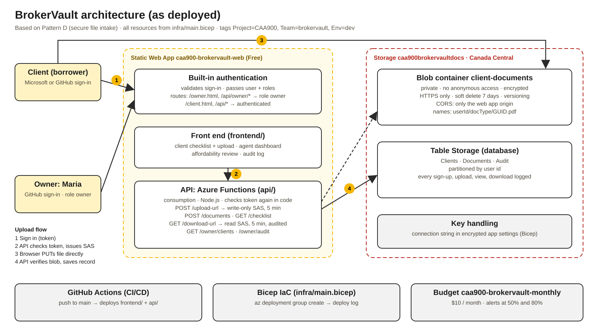

# BrokerVault

A secure document portal for an independent mortgage agent and her clients. CAA900 capstone, Fall 2026, team **BrokerVault** (solo).

**Live:** https://mango-mushroom-0d076930f.6.azurestaticapps.net

| | |
|---|---|
| Customer view | `/client.html` (sign in with a Microsoft or GitHub account) |
| Owner view | `/owner.html` and `/calculator.html` (owner role only) |
| API | `/api/*` on the same domain (see [docs/api.md](docs/api.md)) |
| Platform | Microsoft Azure: data in Canada Central, Static Web App host in East US 2 |

## The problem

**Maria Chen** is an independent mortgage agent in Toronto who works alone. Every client must send her 10 or more confidential documents (pay stubs, T4s, notices of assessment, bank statements, ID, employment letter). Today they arrive by email, text and WhatsApp, and she tracks what is missing in Excel.

> "I never know who is still missing what, I spend hours chasing people, and honestly I'm nervous about bank statements and SINs sitting in my email."

**Success measure:** a complete document package in 3 days or less instead of about 14, with zero confidential documents sent by plain email.

## What it does

1. **Client portal:** a client signs in, sees a checklist of six documents, and uploads PDF, JPG or PNG files straight to private storage. Files that are not really PDF, JPG or PNG are rejected and deleted. Word files are not accepted (macros); the page explains how to save as PDF.
2. **Agent dashboard:** Maria sees every client with what is received and missing, opens a client file, downloads documents through 5-minute links, and reads the audit log. **Send reminder** opens her own mail app with an email listing the missing documents and the secure upload link, and records when each client was last reminded ([ADR 0006](docs/adr/0006-reminders-from-owner-mailbox.md)).
3. **Affordability review:** reads income from the client's T4, notice of assessment or pay stub (the PDF text layer, or Azure AI Document Intelligence OCR for scans and phone photos; Maria confirms it), then calculates the maximum purchase price with the Canadian rules: GDS 39% or less, TDS 44% or less, stress test at the higher of contract rate + 2% and 5.25%, minimum down payment tiers and CMHC premiums. Maria saves the review and exports a one-page PDF summary.

## Architecture

Based on reference **Pattern D (secure file intake)**.



| Service | Role | Why |
|---|---|---|
| Azure Static Web Apps (Free) `caa900-brokervault-web` | Front end, sign-in, role-based route rules | Free; built-in auth (the Seneca tenant blocks new Entra apps) |
| Azure Functions (managed, consumption) | API, 12 functions, Node.js 20 | Pay per use, scales to zero ([ADR 0001](docs/adr/0001-functions-consumption.md)) |
| Blob Storage `caa900brokervaultdocs`, container `client-documents` | The documents | Private, encrypted, 5-minute SAS links, soft delete and versioning |
| Table Storage (same account) | Clients, Documents, Audit, Reviews | Simple keyed records, no server ([ADR 0003](docs/adr/0003-table-storage.md)) |
| Azure AI Document Intelligence (F0) `caa900-brokervault-docintel` | OCR (prebuilt-read) for scanned or photographed income documents | Free tier, 500 pages a month; only called when a file has no text layer |
| Application Insights + Log Analytics `caa900-brokervault-insights` / `-logs` | API request logs; alert `caa900-brokervault-api-failures` emails the owner on server errors | Free allowance; 1 GB daily cap and 30-day retention |
| Bicep `infra/main.bicep` | Creates every resource and setting | Rebuild in minutes ([ADR 0004](docs/adr/0004-bicep.md)) |
| GitHub Actions | Deploys the site and API on every push to `main` | No manual steps |

**Upload flow:** (1) the client signs in; (2) the API checks the token and returns a write-only SAS link for one new blob, valid 5 minutes; (3) the browser uploads directly to private storage; (4) the API checks the real file type and size, deletes bad files, and records good ones in Table Storage and the audit log.

## Security

- **Roles:** anonymous users see only the home page; a client sees only their own files (the API takes the user id from the token, never from the request); the `owner` role is checked in `frontend/staticwebapp.config.json` **and** again in every owner Function ([ADR 0002](docs/adr/0002-swa-built-in-auth.md)).
- **Files:** private container, no anonymous access, write-only and read-only SAS links that expire in 5 minutes, CORS limited to the site, HTTPS and TLS 1.2 only.
- **Secrets:** no keys in this repository. The storage connection string and the Document Intelligence key are written by Bicep into the Static Web App's encrypted app settings; the deploy token is the GitHub secret `AZURE_STATIC_WEB_APPS_API_TOKEN`. Managed functions cannot use a managed identity, so the storage key is rotated with no downtime ([ADR 0005](docs/adr/0005-storage-key-not-managed-identity.md), [runbook](docs/runbooks/rotate-storage-key.md)).
- **Monitoring:** every API call is logged in Application Insights; an alert emails the owner when the API returns server errors.
- **Audit:** sign-ups, uploads, rejected files, client views, downloads, income reads and reviews are logged.
- **Test data:** every sample document and sample client is fictional.

## Repository layout

| Path | Contents |
|---|---|
| `frontend/` | Static pages (`index`, `client`, `owner`, `calculator`), `app.js`, styles, route rules, vendored jsPDF (MIT) |
| `api/` | Azure Functions (12); shared helpers in `api/shared/` |
| `infra/main.bicep` | Infrastructure as Code |
| `.github/workflows/` | CI/CD pipeline |
| `docs/` | API, decisions (ADRs), architecture, cost log, meetings, evidence ([index](docs/README.md)) |

## Deploy it

Prerequisites: an Azure subscription, the Azure CLI (or Cloud Shell) and this repository.

```bash
# 1. Infrastructure (about 3 minutes)
az group create -n caa900-brokervault-rg -l canadacentral \
  --tags Project=CAA900 Team=brokervault Env=dev
az deployment group create -g caa900-brokervault-rg -f infra/main.bicep -n brokervault-deploy \
  -p alertEmail=<email for alerts>

# 2. Deployment token for GitHub Actions (store it as the repository secret
#    AZURE_STATIC_WEB_APPS_API_TOKEN; never commit it)
az staticwebapp secrets list -n caa900-brokervault-web --query properties.apiKey -o tsv
```

3. Push to `main` (or run the workflow by hand): GitHub Actions deploys `frontend/` and `api/`.
4. In the Static Web App, **Role management → Invite**, give the agent's account the role `owner`.

Recovery test and key rotation: [docs/runbooks/](docs/runbooks/).

## Cost

$0.00 spent so far; expected under $1 a month at Maria's size (the alert rule is about $0.10 a month; Document Intelligence F0 and the logs stay within free allowances). Budget `caa900-brokervault-monthly`: $10 a month, alerts at 50% and 80%. See [docs/cost-log.md](docs/cost-log.md).

## Team

| Name | GitHub | Owns |
|---|---|---|
| Xinmeng Yuan | CrystalYuanxm | Everything: front end, API, database, cloud and security, CI/CD |
